# Guía de uso de ApiDental

Cómo trabajar en el panel según su rol, con capturas de la versión demo. Los pacientes, citas y montos son ficticios. Generado por `build.py`.

## Contenido

- [Primeros pasos](#primeros-pasos)
- [Qué puede hacer cada rol](#qué-puede-hacer-cada-rol)
- [Recepción](#recepción)
- [Odontólogo](#odontólogo)
- [Asistente](#asistente)
- [Director clínico](#director-clínico)
- [Cajero](#cajero)
- [Administrador de clínica](#administrador-de-clínica)
- [Administrador de plataforma](#administrador-de-plataforma)
- [Preguntas frecuentes](#preguntas-frecuentes)
- [Lo que todavía no está en el panel](#lo-que-todavía-no-está-en-el-panel)

## Primeros pasos

### Ingresar

1. Abra `https://dental.apiworking.com.pe/admin/` en su navegador.
2. Escriba su **correo** y su **contraseña**. Con «Mostrar contraseña» puede comprobar lo que escribe.
3. Pulse **Ingresar**.

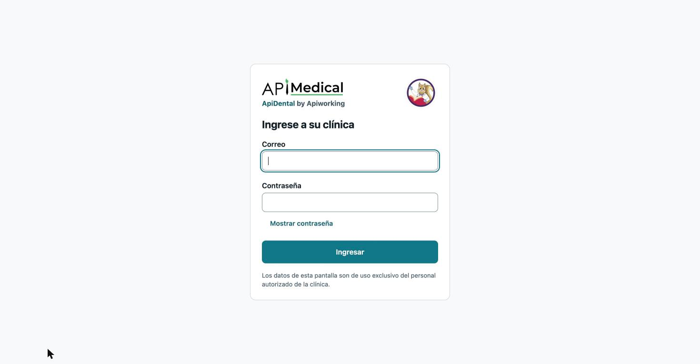
*Pantalla de ingreso.*

> **Tenga en cuenta.** Después de **5 intentos fallidos** seguidos la cuenta se bloquea 15 minutos. Si olvidó su contraseña, pida a su administrador que la restablezca.

### Elegir dónde trabaja

Si su usuario tiene más de una clínica o sede, aparece esta pantalla. Elija una. Para cambiar más tarde use **Cambiar sede**, abajo a la izquierda del menú.

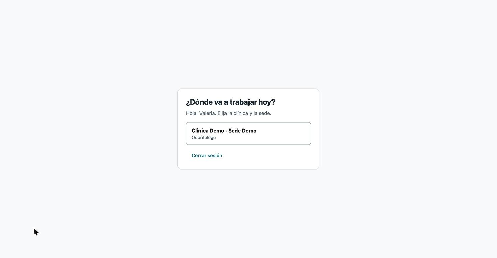
*Selección de clínica y sede. Con un solo lugar de trabajo se entra directo.*

### Cómo está organizada la pantalla

- **Menú de la izquierda.** Solo muestra lo que su rol puede usar, por eso cada persona ve opciones distintas.
- **Barra amarilla «DEMO — NO VÁLIDO PARA SUNAT».** Indica que cobros, comprobantes, puntos y reseñas son una simulación con datos ficticios. Nada se envía a SUNAT ni a Apiworking. Siempre está visible.
- **Cerrar sesión**, abajo a la izquierda. Ciérrela siempre en equipos compartidos.

### Cuando aparece «Acceso denegado»

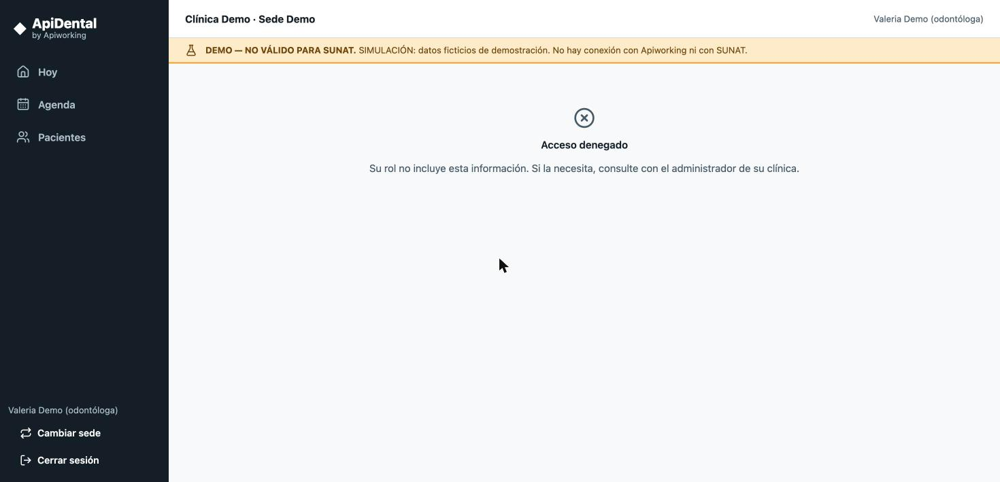
*Su rol no incluye esa información.*

Significa que su rol no puede ver esa pantalla. No es un error. Si necesita ese acceso, consulte con el administrador de su clínica.

## Qué puede hacer cada rol

| Rol | Agenda | Pacientes | Historia clínica y odontograma | Caja | Comprobantes | Fidelización |
|---|---|---|---|---|---|---|
| Recepción | Gestiona | Datos completos y alta | No | Cobra | Ve | Ve |
| Odontólogo | Ve e inicia la atención | Lectura | Sí, de sus pacientes | No | No | No |
| Asistente | Ve | Datos básicos | No | No | No | No |
| Director clínico | Ve | Lectura | Solo por la API, con justificación | No | No | No |
| Cajero | Ve | Datos básicos | No | Cobra | Emite y concilia | Canjea puntos |
| Administrador de clínica | Gestiona | Datos completos y alta | No | Cobra | Emite y concilia | Canjea puntos |
| Administrador de plataforma | No | No | No | No | No | No |

## Recepción

Cuenta demo: `recepcion.demo@apidental.test`. Agenda, citas, datos del paciente y cobros.

Recepción organiza la agenda, mantiene los datos del paciente y cobra la atención.

### 1. Revisar el día

La pantalla **Hoy** resume las citas del día: cuántas hay, cuántas faltan por confirmar y las ausencias. Los nombres de la lista abren la ficha del paciente.

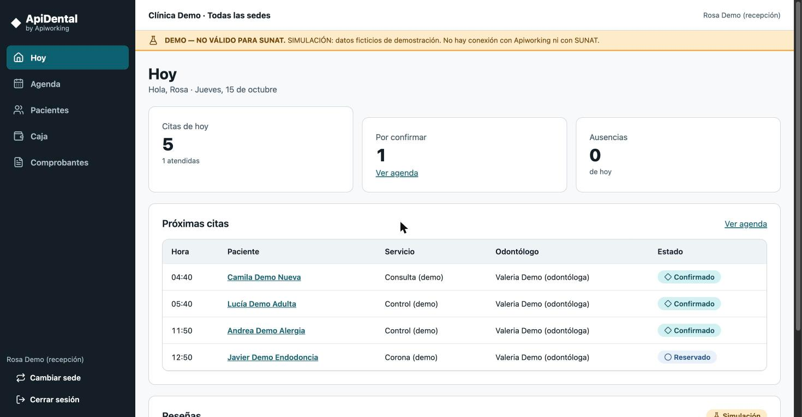
*Hoy, vista de recepción.*

### 2. Ver la agenda

En **Agenda** elija la fecha, la vista (día o semana en lista) y el odontólogo. Cada cita muestra la hora, el paciente, el servicio, el consultorio y su estado.

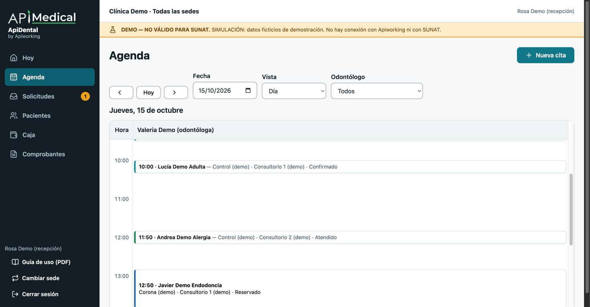
*Agenda del día por odontólogo.*

### 3. Reservar una cita

1. Pulse **Nueva cita** (en la agenda o en la ficha del paciente).
2. Busque al **paciente** por DNI, nombre o celular (mínimo 2 caracteres) y elíjalo.
3. Elija **servicio**, **odontólogo** y **fecha**. Aparecen los **horarios disponibles**; elija uno.
4. Si hace falta, agregue una nota administrativa y pulse **Reservar cita**.

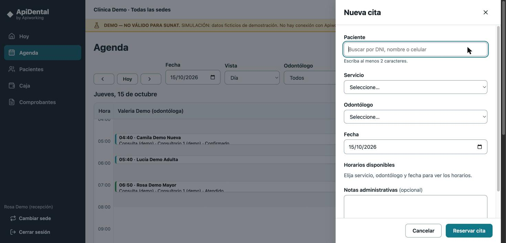
*Formulario de nueva cita.*

> **Tenga en cuenta.** Solo se ofrecen horarios libres según el horario del odontólogo, su consultorio y la duración del servicio. No se puede reservar encima de otra cita.

#### Si el paciente todavía no está registrado

Si la búsqueda no encuentra a nadie, aparece **Crear paciente nuevo** en la misma lista. No necesita salir de la cita.

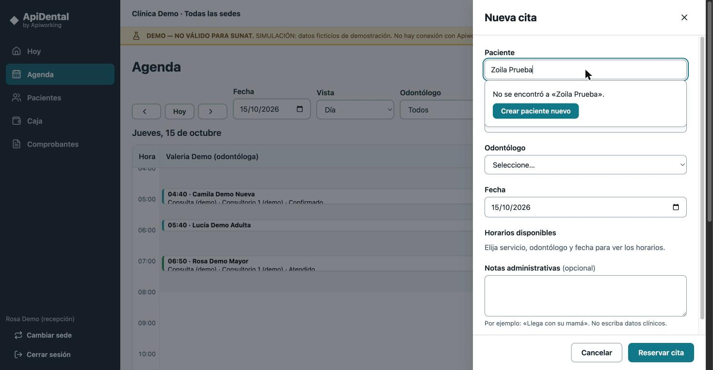
*La búsqueda no encontró al paciente y ofrece crearlo ahí mismo.*

1. Pulse **Crear paciente nuevo**. El formulario se abre encima de la cita, con lo que ya escribió (nombres, DNI o celular).
2. Complete **nombres** y **apellido paterno** (obligatorios). El resto es opcional: documento, apellido materno, fecha de nacimiento, sexo, celular y correo.
3. Pulse **Crear paciente**. Queda elegido en la cita y puede seguir con el servicio, el odontólogo y el horario.

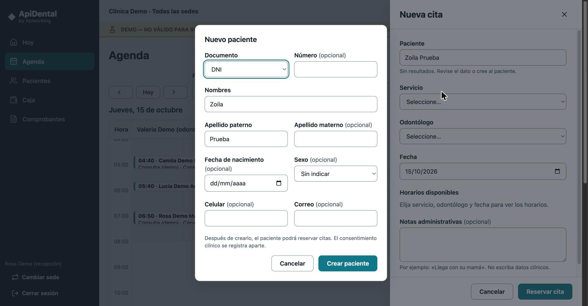
*Formulario de nuevo paciente.*

Antes de crear, el sistema revisa si la persona ya existe:

- **Mismo documento:** no crea otra ficha. Le ofrece **Usar a este paciente**.
- **Nombre, celular o correo parecidos:** le muestra a quién se parece. Elija **Usar a este paciente** si es la misma persona, o **Crear de todos modos** si es otra.

> **Tenga en cuenta.** Para un menor de edad, cree primero al paciente y luego registre a su representante, porque el consentimiento lo da el representante.

### 4. Gestionar una cita

Pulse una cita de la agenda para abrir su detalle.

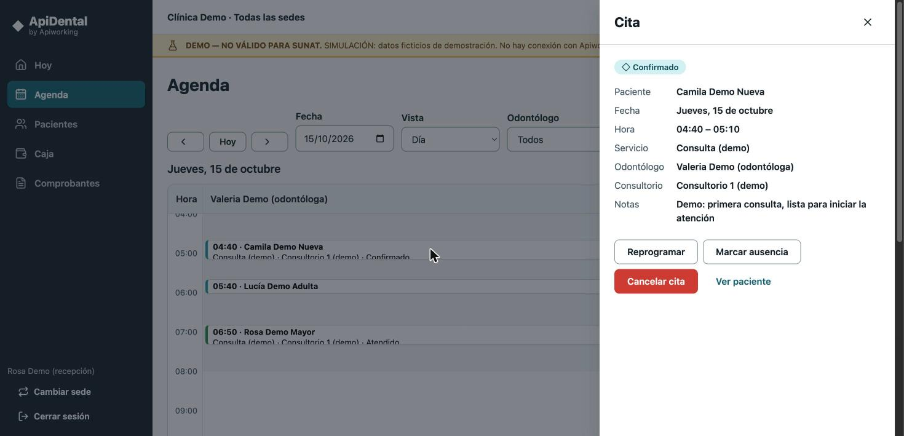
*Detalle de la cita con sus acciones.*

- **Confirmar**: cuando el paciente avisó que viene. Pasa de «Reservado» a «Confirmado».
- **Reprogramar**: elija otro horario disponible. La cita guarda cuántas veces se movió.
- **Cancelar cita**: pide un motivo (mínimo 3 caracteres).
- **Marcar ausencia**: disponible desde la hora de inicio, si el paciente no llegó. Pide un motivo.
- **Ver paciente**: abre su ficha.

Estados de una cita: Reservado → Confirmado → Atendido. También puede terminar en Cancelado o Ausente.

### 5. Buscar al paciente y ver su ficha

En **Pacientes** busque por DNI, nombre o celular y pulse el nombre.

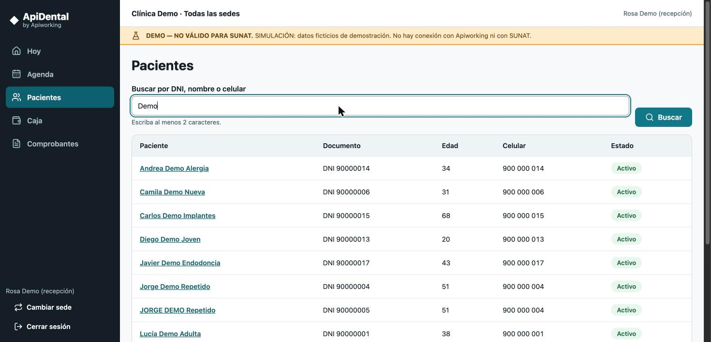
*Búsqueda de pacientes.*

La ficha reúne la identificación, las citas y la tarjeta de fidelización simulada con su saldo de puntos.

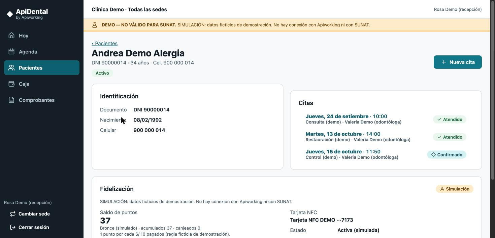
*Ficha del paciente.*

#### Registrar un paciente nuevo

En **Pacientes** pulse **Nuevo paciente** (arriba a la derecha). Si busca a alguien que no existe, también aparece el botón **Crear a «nombre»** y el formulario ya viene con lo que escribió.

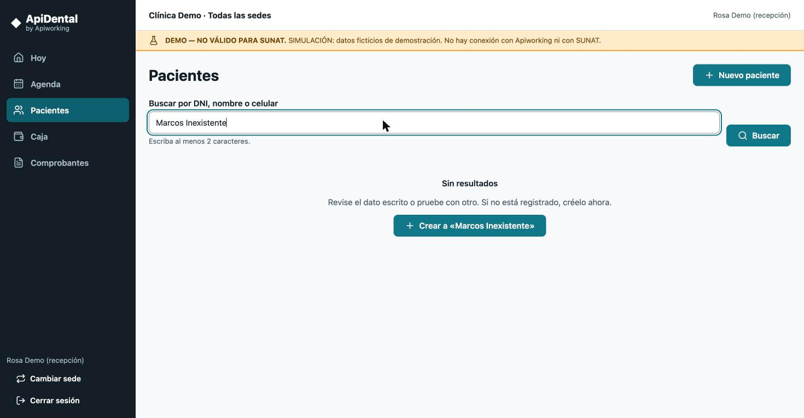
*Sin resultados: se puede crear al paciente desde la misma pantalla.*

El formulario y las revisiones de duplicados son los mismos que al reservar una cita. Al terminar se abre la ficha del paciente nuevo.

> **Todavía no.** Aún **no hay pantalla para editar los datos** de un paciente ya creado, ni para sus consentimientos y adjuntos. Eso se hace hoy por la API. La historia clínica y el odontograma no son visibles para recepción.

### 6. Cobrar una atención

1. Cuando el odontólogo atendió la cita, ábrala en la agenda y pulse **Registrar cobro**. También puede entrar por **Caja** y elegir el cobro pendiente.
2. En **Caja** verá todos los cobros con su fecha, paciente, concepto, monto y estado.

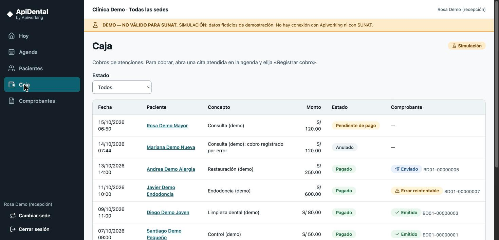
*Caja: lista de cobros. Se puede filtrar por estado.*

1. Abra el cobro pendiente.
2. Elija el **medio de pago**: efectivo, tarjeta, transferencia o Yape/Plin.
3. Pulse **Registrar pago**.

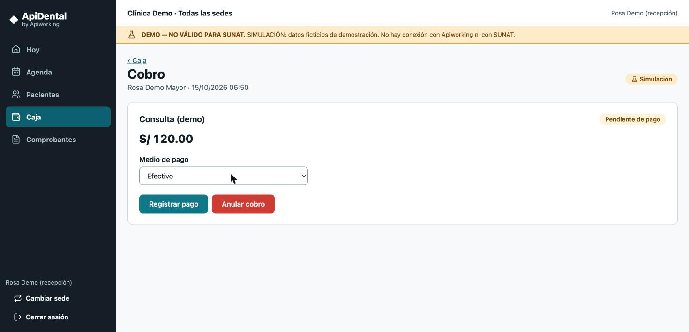
*Cobro pendiente de pago.*

> **Tenga en cuenta.** Si el cobro se creó por error, use **Anular cobro**. El cobro queda anulado y visible en la lista; no se borra.

### 7. Ver el comprobante

Al pagar, se encolan los puntos de fidelización y la solicitud de reseña (simulados). El comprobante aparece debajo del cobro, siempre con la marca **«DEMO — NO VÁLIDO PARA SUNAT»**.

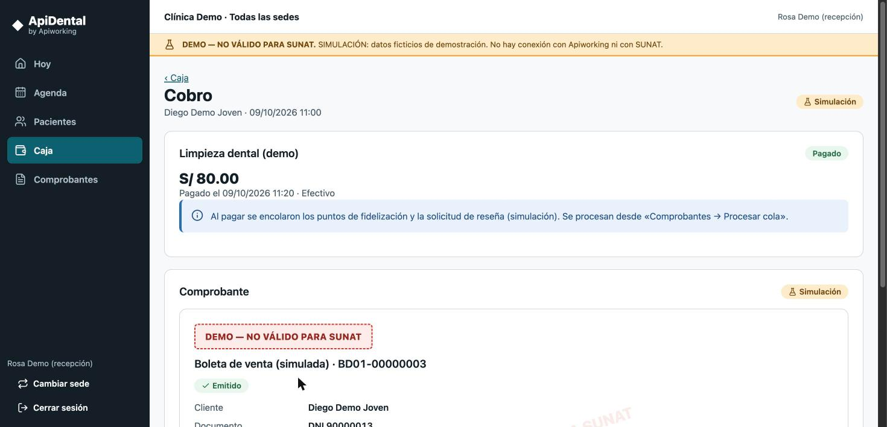
*Cobro pagado.*

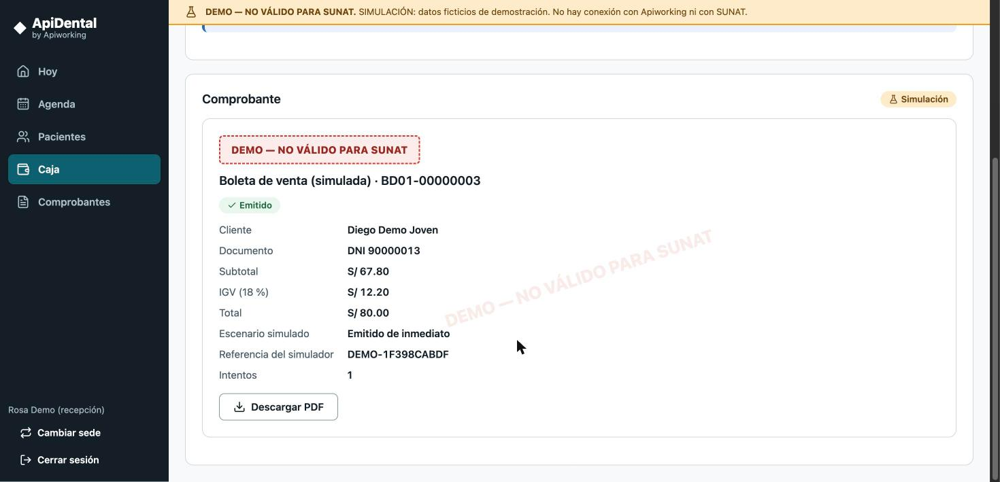
*Boleta simulada emitida, con subtotal, IGV y total.*

En **Comprobantes** está la lista de todos los emitidos, con su estado.

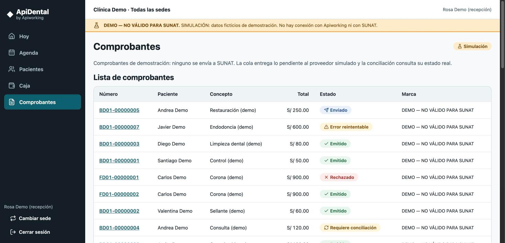
*Lista de comprobantes.*

Abajo está la **cola de integraciones**: lo que quedó pendiente de enviar (comprobantes, puntos y reseñas) y qué pasó con cada tarea.

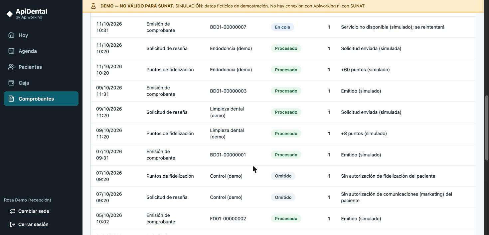
*Cola de integraciones.*

> **Tenga en cuenta.** Recepción **ve** los comprobantes. Emitirlos, reintentarlos o conciliarlos lo hace Caja.

## Odontólogo

Cuenta demo: `odontologa.demo@apidental.test`. Atiende a sus pacientes y registra el odontograma.

El odontólogo atiende a los pacientes con los que tiene relación asistencial vigente y registra el odontograma. Solo ve la historia clínica de esos pacientes.

### 1. Revisar el día

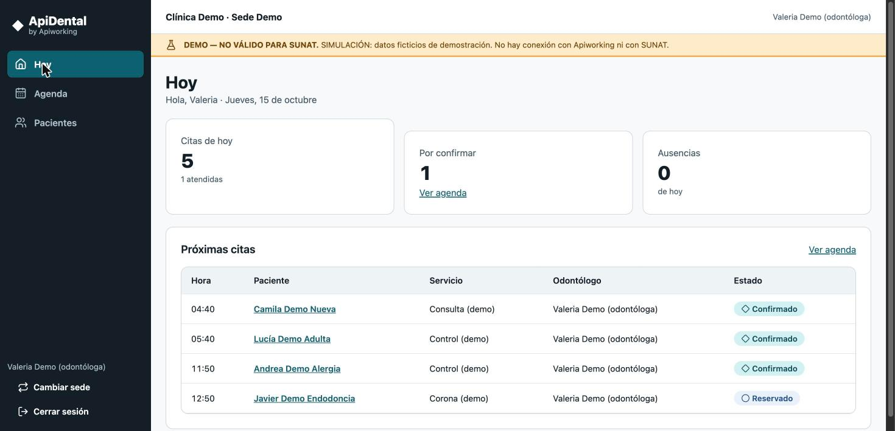
*Hoy, vista del odontólogo. No tiene Caja ni Comprobantes.*

### 2. Iniciar la atención

1. En **Agenda** abra la cita del paciente.
2. Pulse **Iniciar atención**. Se abre una visita clínica y la cita pasa a «Atendido».

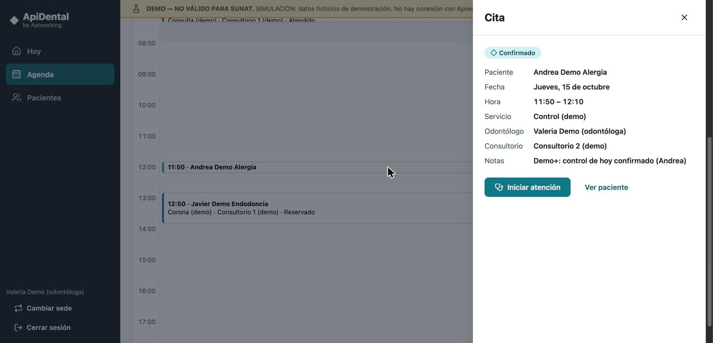
*Cita lista para iniciar la atención.*

> **Tenga en cuenta.** El botón aparece desde **30 minutos antes** de la hora de la cita y hasta **6 horas después** de que termina. Fuera de esa ventana, solo se ve «Ver paciente».

### 3. La ficha de atención

Arriba aparecen las **alertas** del paciente: alergias registradas, avisos y si tiene consentimiento clínico vigente. Léalas antes de empezar.

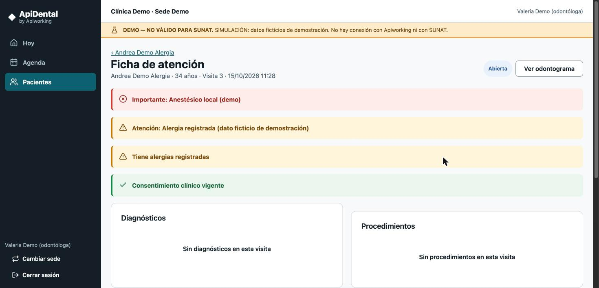
*Ficha de atención con alertas de alergia y consentimiento.*

Más abajo están los diagnósticos, los procedimientos, la evolución y el resumen del odontograma de la visita.

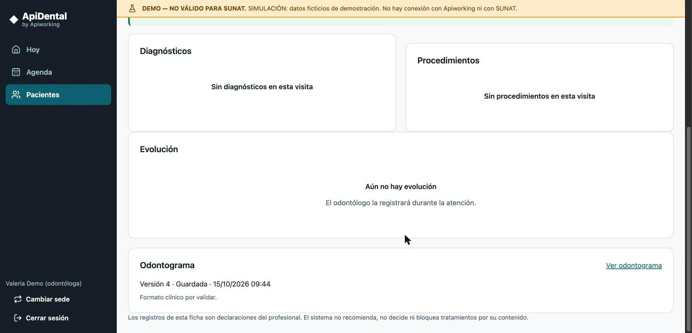
*Secciones de la ficha.*

> **Todavía no.** En el panel, **diagnósticos, procedimientos y evolución se muestran en solo lectura**. Hoy se registran por la API. Lo que sí se edita desde el panel es el odontograma.

### 4. Registrar el odontograma

Desde la ficha pulse **Ver odontograma**, o entre por la ficha del paciente. Según el caso verá:

- **Iniciar odontograma**: si el paciente no tiene ninguno.
- **Actualizar odontograma**: abre un borrador nuevo a partir de la última versión guardada.
- **Corregir la versión guardada**: para corregir un error. Pide el motivo y, al guardar, su contraseña.

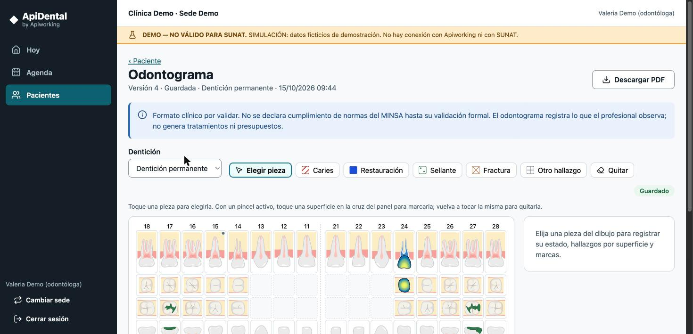
*Editor del odontograma: dentición, pinceles y estado del guardado.*

Cada pieza (numeración FDI) se dibuja con su raíz y, en premolares y molares, su cara oclusal. Para marcar:

1. **Toque una pieza** para elegirla. Se abre su panel a la derecha.
2. Elija un **pincel** (Caries, Restauración, Sellante, Fractura u Otro hallazgo) y toque una **superficie** en la cruz del panel: V vestibular, L lingual o palatina, M mesial, D distal, O oclusal o incisal.
3. Para quitar un hallazgo, toque la misma superficie otra vez o use el pincel **Quitar**.
4. En el panel también puede indicar el **estado de la pieza** (presente, ausente, sin erupcionar, implante o resto radicular), las **marcas** (corona, endodoncia, prótesis) y una nota.

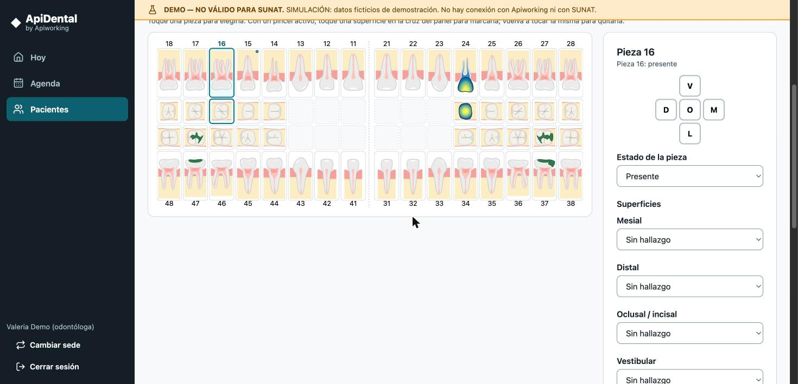
*Pieza 16 elegida, con la cruz de superficies y su detalle.*

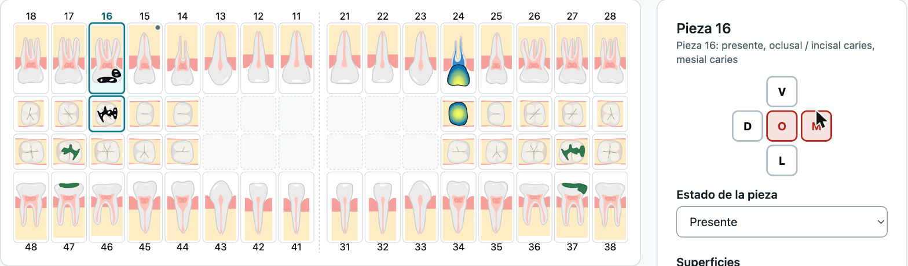
*Caries marcadas en las superficies oclusal y mesial de la pieza 16. Se pintan sobre el propio diente.*

- **Dentición:** cambie entre permanente, temporal y mixta con el selector de arriba.
- **Se guarda solo.** El indicador «Guardado» confirma que el borrador está a salvo. No necesita pulsar nada para no perder el trabajo.
- Con las flechas del teclado puede moverse entre piezas y con Enter elegirla.

### 5. Guardar la versión

Al terminar, escriba las notas generales si las hay y pulse **Guardar versión**. La versión queda **inmutable**: no se puede cambiar. Para modificar algo después, se abre otra versión y se conserva el historial completo.

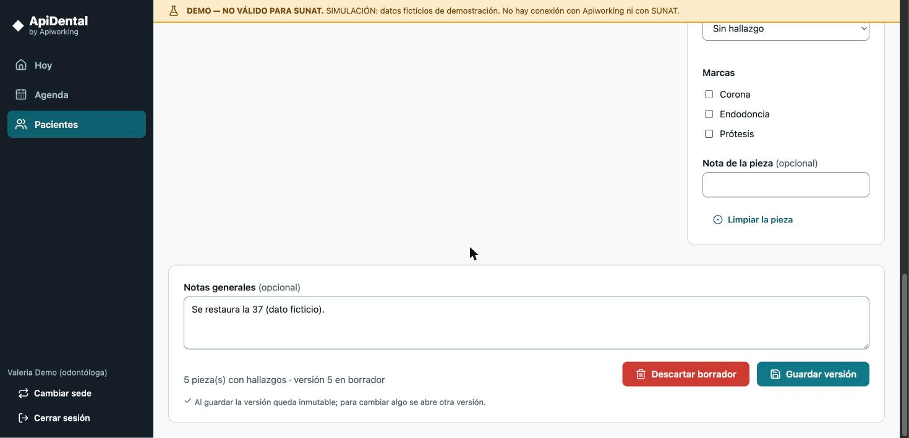
*Notas generales, Descartar borrador y Guardar versión.*

Si abrió el borrador por error, pulse **Descartar borrador**: pide un motivo, y la última versión guardada no cambia.

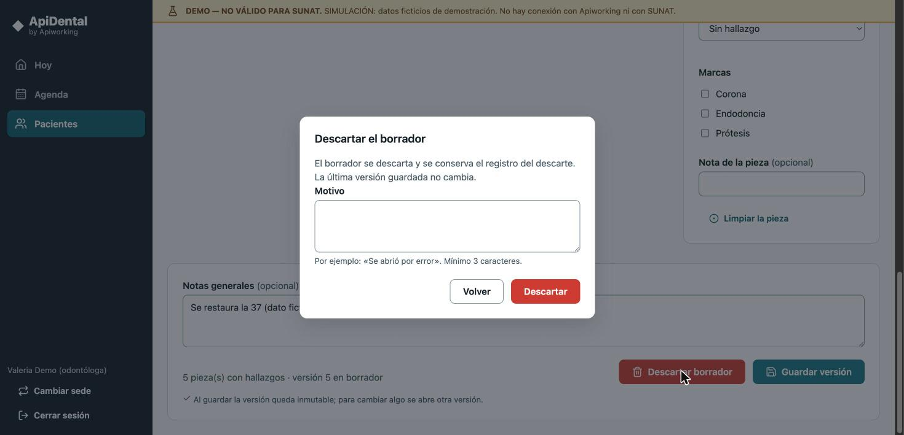
*Descartar el borrador.*

> **Tenga en cuenta.** Se confirma con su contraseña únicamente al guardar una **corrección**. Esa confirmación no es una firma digital, legal ni clínica.

> **Todavía no.** El odontograma registra **lo que usted observa o declara**. El sistema no sugiere diagnósticos ni tratamientos. El formato clínico está **por validar** y no se declara cumplimiento de normas del MINSA.

### 6. La ficha del paciente

En **Atención clínica** están todas las visitas del paciente, abiertas o cerradas, con acceso directo a cada ficha y al odontograma.

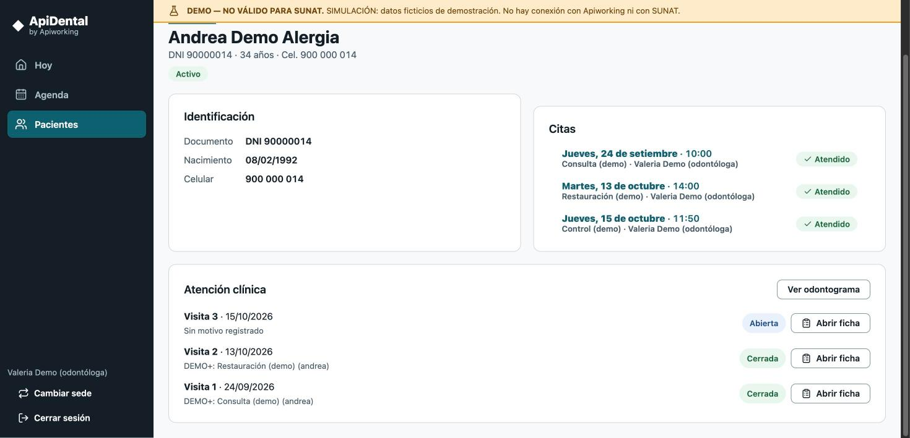
*Ficha del paciente con su historial de visitas.*

## Asistente

Cuenta demo: `asistente.demo@apidental.test`. Apoyo: consulta la agenda y los datos básicos.

El asistente apoya la atención. Consulta la agenda y los datos básicos de los pacientes.

*Hoy, vista del asistente. El menú solo tiene Hoy, Agenda y Pacientes.*

En la ficha del paciente ve su identificación y sus citas. La historia clínica, la evolución y el odontograma no están disponibles para este rol.

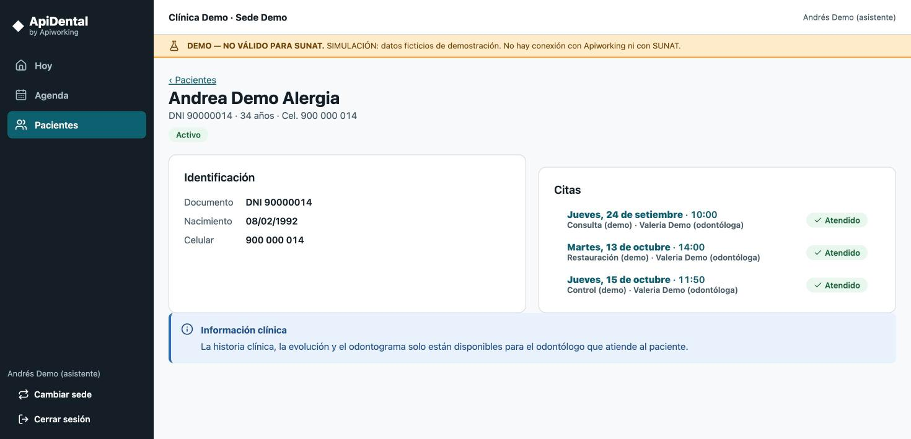
*Ficha del paciente: información clínica reservada al odontólogo.*

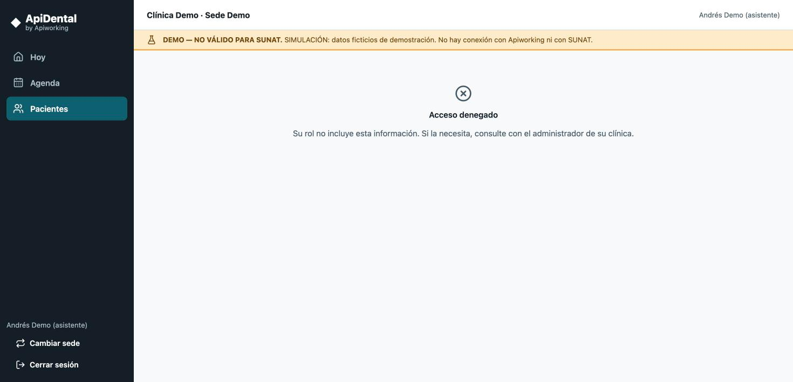
*Si abre una ficha clínica por un enlace, verá «Acceso denegado».*

> **Tenga en cuenta.** El asistente puede consultar la agenda, pero no reserva, reprograma ni cancela citas. Eso lo hace Recepción.

## Director clínico

Cuenta demo: `director.demo@apidental.test`. Autoridad clínica de la clínica; consulta agenda y pacientes.

El director clínico es la autoridad clínica de la clínica. En el panel consulta la agenda y los datos de los pacientes.

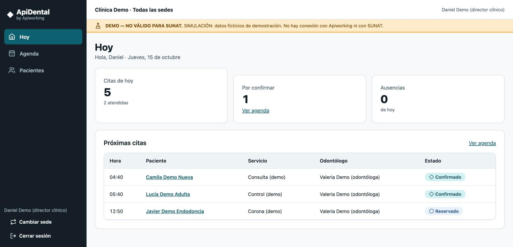
*Hoy, vista del director clínico.*

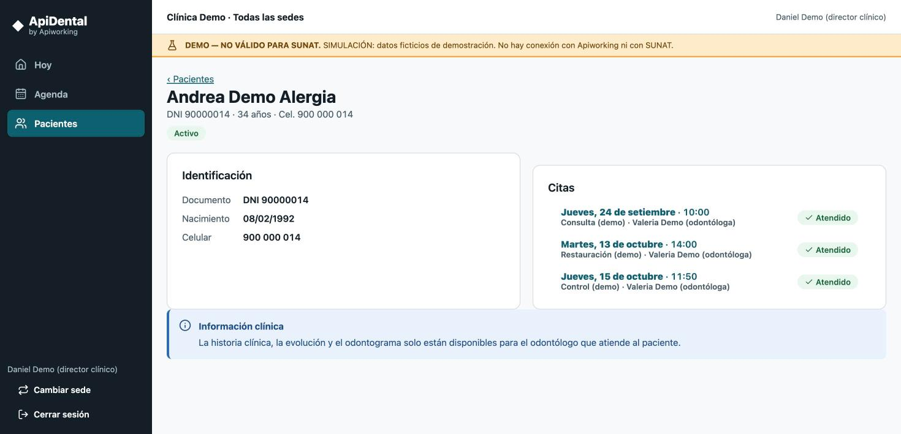
*Ficha del paciente. La historia clínica queda reservada al odontólogo que atiende.*

> **Todavía no.** El director puede leer la historia de **un paciente por vez**, de forma excepcional, con justificación, confirmación de contraseña y registro de auditoría. Esa lectura **todavía no tiene pantalla** en el panel y se hace por la API.

## Cajero

Cuenta demo: `cajero.demo@apidental.test`. Caja, comprobantes y puntos de fidelización.

El cajero registra los pagos, emite y concilia los comprobantes simulados y canjea puntos de fidelización.

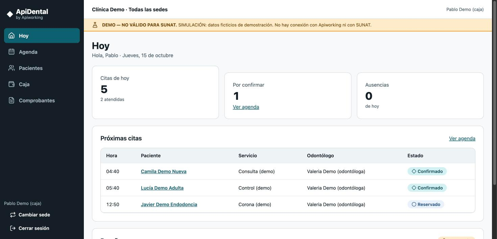
*Hoy, vista del cajero. El menú incluye Caja y Comprobantes.*

### 1. Cobrar

En **Caja** están todos los cobros. Abra un cobro **pendiente**, elija el medio de pago y pulse **Registrar pago**. Es el mismo flujo que en Recepción (ver la pantalla de Caja allí).

### 2. Emitir el comprobante simulado

1. Abra un cobro **pagado** que aún no tenga comprobante.
2. Elija **Boleta** o **Factura**. La factura pide un RUC de 11 dígitos y la razón social, ambos ficticios.
3. Elija el **escenario de simulación**: emitido de inmediato, pendiente, rechazado o con reintento. Sirve para mostrar cómo responde cada caso.
4. Pulse **Emitir comprobante simulado**.

El comprobante nace con la marca **«DEMO — NO VÁLIDO PARA SUNAT»**, un número correlativo y un estado.

### 3. Comprobantes, cola y conciliación

En **Comprobantes** el cajero tiene dos botones que Recepción no ve:

- **Procesar cola**: entrega al proveedor simulado lo pendiente (comprobantes, puntos y reseñas).
- **Conciliar pendientes**: consulta el estado real de los comprobantes que quedaron «Enviado» o «Requiere conciliación».

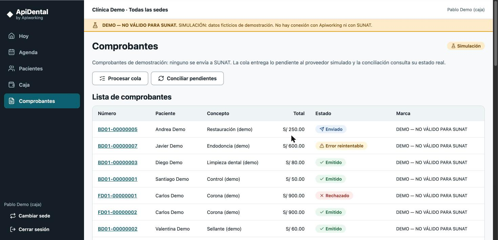
*Comprobantes con Procesar cola y Conciliar pendientes.*

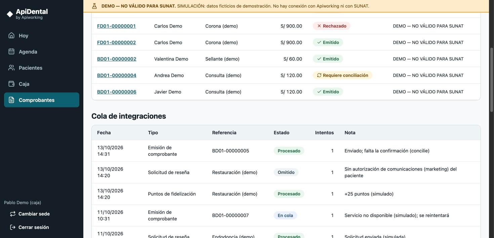
*Cola de integraciones: procesado, en cola u omitido, con el motivo.*

#### Qué significa cada estado de comprobante

- **Emitido**: aceptado por el proveedor simulado.
- **Enviado**: se envió y falta la confirmación. Use Conciliar.
- **Requiere conciliación**: no se sabe el resultado. Use Conciliar.
- **Error reintentable**: falló por algo temporal. Use Reintentar en el detalle del cobro.
- **Rechazado**: el proveedor simulado lo rechazó y muestra el motivo.

> **Tenga en cuenta.** Si un comprobante fue rechazado, se puede emitir uno nuevo desde el mismo cobro; tendrá otro número.

> **Tenga en cuenta.** Procesar cola y Reintentar son seguros de repetir: un cobro no genera dos comprobantes ni suma los puntos dos veces.

### 4. Canjear puntos

En la ficha del paciente, la tarjeta **Fidelización** muestra su nivel, su saldo y el estado de su tarjeta NFC (simulada). Si el cajero está autorizado, escriba los puntos en **Canjear puntos** y pulse **Canjear**. Un paciente solo acumula puntos si autorizó la fidelización.

## Administrador de clínica

Cuenta demo: `admin.dev@apidental.test`. Todo lo de recepción y caja, más la administración de su clínica.

El administrador de clínica tiene el mismo panel que Recepción y Caja juntos: agenda, pacientes, cobros, comprobantes y fidelización. Además administra a las personas de su clínica.

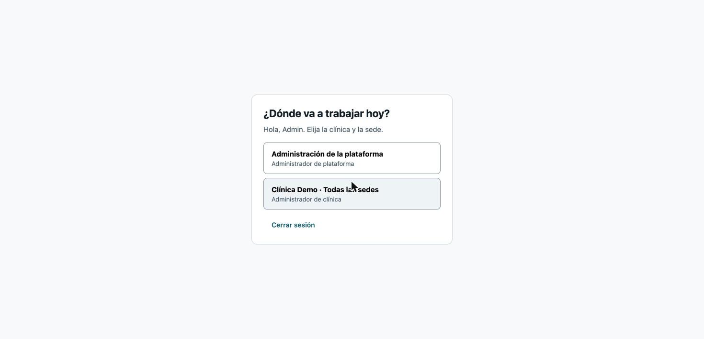
*Este usuario tiene dos asignaciones: administración de la plataforma y administración de la clínica.*

*Hoy, con la clínica elegida.*

Para las tareas del día siga las guías de **Recepción** y **Cajero**.

> **Todavía no.** **Usuarios, sedes, roles e invitaciones no tienen pantalla** en el panel todavía. Se administran por la API. El envío de invitaciones requiere configurar el canal de entrega, que hoy está desactivado.

## Administrador de plataforma

Cuenta demo: `admin.dev@apidental.test`. Opera la plataforma. No ve datos de pacientes.

El administrador de plataforma opera la plataforma. Por diseño **no tiene acceso a datos de pacientes**. Si el mismo usuario también administra una clínica, elija esa asignación al ingresar o con **Cambiar sede**.

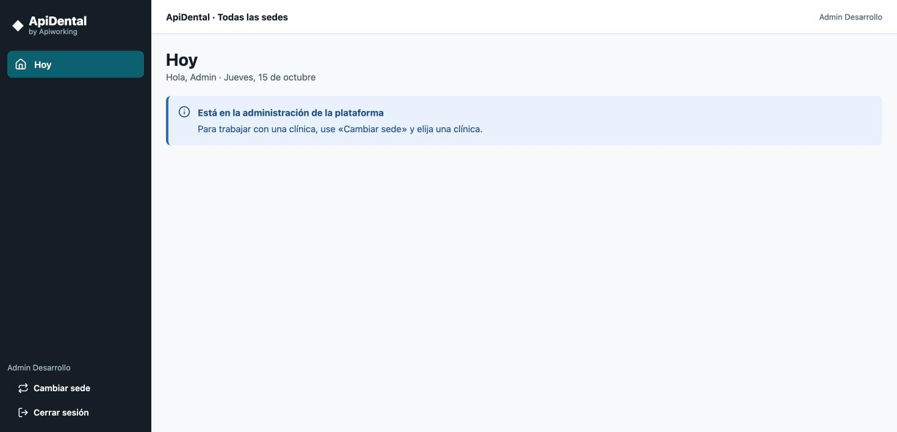
*En la administración de la plataforma solo existe la pantalla Hoy.*

## Preguntas frecuentes

**No veo el botón «Iniciar atención».**  
Solo aparece para el odontólogo de la cita, desde 30 minutos antes de su hora y hasta 6 horas después de terminar, y mientras la cita no esté cancelada ni marcada como ausencia.

**Me aparece «Acceso denegado».**  
Su rol no incluye esa pantalla. Consulte la tabla de roles. Si la necesita, pida el cambio a su administrador.

**Mi sesión se cerró sola.**  
Por seguridad la sesión caduca. Ingrese de nuevo. En equipos compartidos use siempre Cerrar sesión.

**No encuentro al paciente.**  
Busque por DNI, nombre o celular con al menos 2 caracteres. Si no existe, recepción puede crearlo desde Pacientes o desde la propia cita con «Crear paciente nuevo». Los demás roles deben pedírselo a recepción.

**Al crear un paciente me dice que ya existe.**  
Otra ficha tiene el mismo documento, o se parece por nombre, celular o correo. Use «Usar a este paciente» para no duplicar. El sistema nunca fusiona fichas por su cuenta.

**Un comprobante dice «DEMO — NO VÁLIDO PARA SUNAT».**  
Es correcto. Esta versión simula la facturación para mostrar el flujo. No hay conexión con SUNAT ni con Apiworking, y esos comprobantes no tienen validez tributaria.

**Un comprobante quedó en «Error reintentable» o «Requiere conciliación».**  
Es un caso previsto. Pida a Caja que use Reintentar o Conciliar. Nada se duplica.

**Guardé un odontograma con un error.**  
Una versión guardada no se modifica. Abra «Corregir la versión guardada», indique el motivo y confirme con su contraseña. Queda el historial de ambas versiones.

## Lo que todavía no está en el panel

- Editar los datos de un paciente ya creado, y registrar consentimientos, representantes y adjuntos desde el panel (hoy por la API).
- Registrar diagnósticos, procedimientos y evolución desde el panel (hoy en solo lectura).
- Planes de tratamiento, presupuestos, cuotas y saldos.
- Apertura y cierre de caja, pagos parciales y cuentas por cobrar.
- Reportes y tablero de gestión.
- Recordatorios por WhatsApp o SMS y confirmación de asistencia por el paciente.
- Letreros NFC y métricas de reseñas, tarjeta en Wallet, cumpleaños y referidos.
- Administración de usuarios, sedes e invitaciones desde el panel.
